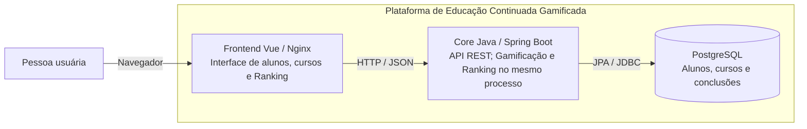
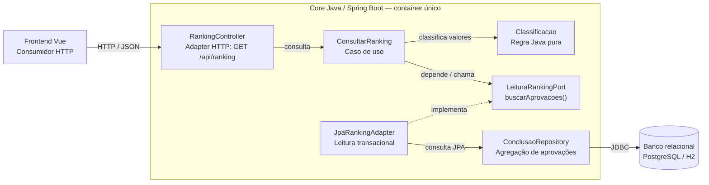

# Grupo 5 - Prática ATDD

## Educação Continuada Gamificada

Projeto desenvolvido para a disciplina de DevOps & QA utilizando os conceitos de Acceptance Test Driven Development (ATDD), combinando BDD e TDD.

O estudo de caso é uma plataforma de educação continuada gamificada. Alunos dos planos Básico ou Premium concluem cursos, recebem três cursos adicionais a cada conclusão aprovada (curso concluído e nota final de pelo menos 7,0) e podem consultar o histórico de tentativas e liberações acumuladas.

## Evolução arquitetural B1

**Entrega B1: Desafios 1 e 2 concluídos no recorte descrito abaixo.** Este README reúne os requisitos, as decisões, os diagramas e os resultados para avaliação. Os Desafios 3–6 ficam fora desta entrega. A esteira Jenkins e a observabilidade existentes são reutilizadas, preservando as configurações anteriores ao fechamento.

A cadeia adotada é **RF → RNF → ASR + RPC → alternativas/trade-offs → ADR → C4 → evidência**. RF descreve comportamento; RNF descreve qualidade; ASR é o RNF que influencia a arquitetura; RPC registra restrições e premissas. Cada desafio seleciona no máximo três ASRs. O [registro arquitetural cumulativo](docs/arquitetura/README.md) preserva o histórico e o detalhamento complementar.

### Desafio 1 — de camadas para monólito modular

O legado da AC1 organizava o Core em camadas técnicas (`api`, `service`, `domain`, `entity` e `repository`). A evolução criou um primeiro módulo de negócio, `gamificacao`, encapsulando aprovação e recompensa. `ConclusaoService` consome o contrato público `AvaliarConclusao`, que recebe `DadosConclusao` e retorna `ResultadoConclusao`; a implementação fica em `internal/dominio/PoliticaConclusao`.

| Elemento | Aplicação no Desafio 1 |
| --- | --- |
| RFs | RF02 Gamificação: preservar aprovação com conclusão e nota ≥ 7, recompensa de três cursos e histórico. RF01 Ranking orienta uma fronteira futura, concretizada no Desafio 2. Cadastros e contratos da AC1 permanecem válidos. |
| RNFs analisados | Manutenibilidade, escalabilidade, complexidade operacional, desempenho e testabilidade. |
| ASR-01 — Manutenibilidade | Contratos por capacidade limitam alterações e impedem acesso externo aos detalhes internos. |
| ASR-02 — Escalabilidade | Preparar fronteiras para eventual extração do Ranking; extração depende de medições de carga. |
| ASR-03 — Complexidade operacional | Manter um único deploy do Core, compatível com a equipe de seis desenvolvedores. |
| RPCs | Reutilizar AC1, Java/Spring Boot, banco relacional e regras existentes; evolução incremental com a equipe atual. |

| Alternativa macro | Benefício | Custo ou limitação |
| --- | --- | --- |
| Monólito em camadas | Operação simples e continuidade imediata | Fronteiras de negócio pouco explícitas e acesso livre entre camadas. |
| **Monólito modular — escolhido** | Contratos internos e evolução por capacidade com transações locais | Requer proteger fronteiras; recursos, banco e deploy continuam compartilhados. |
| Serviços seletivos | Escala e deploy independentes | Rede, falhas parciais e maior custo operacional, sem necessidade demonstrada nesta etapa. |

**ADR-001 — Evoluir o Core para monólito modular.** Diante do legado funcional, dos três ASRs e das RPCs, a decisão foi introduzir contratos de negócio no mesmo processo. O primeiro recorte preserva a transação existente de tentativa e saldo, sem mover toda a persistência. A consequência é maior controle de dependências com operação conjunta; a modularização integral de Alunos e Cursos é evolução posterior ao mini-lab.

**Evidência antes/depois:** antes, `ConclusaoService` conhecia os objetos usados no cálculo; depois, chama `gamificacao.api.AvaliarConclusao → PoliticaConclusao`. Três regras ArchUnit impedem acesso externo a `internal`, dependências técnicas no módulo e exposição de tipos internos pelos records públicos. Os oito cenários de domínio foram preservados pela API do módulo. A [comparação de dependências](docs/arquitetura/evidencias/desafio-1/dependencias.md) registra também a rejeição experimental de violações; a [validação de 28/10](docs/arquitetura/evidencias/desafio-1/validacao.md) aprovou 25 testes normais, um IT PostgreSQL e dez cenários Cypress.

**C4 — visão de containers da aplicação:**



O diagrama mostra a aplicação em Docker/HOMOL; o perfil local utiliza H2. Jenkins, Prometheus e Grafana apoiam entrega e operação, conforme a seção de pipeline deste README.

### Desafio 2 — proteger a regra e inverter a dependência de leitura

**Problema:** a primeira versão funcional do Ranking fazia `ConsultarRanking` acessar diretamente `ConclusaoRepository`. Mesmo com classificação Java pura, a obtenção dos dados permanecia vinculada ao contrato de persistência. A hipótese do mini-lab é substituir essa fonte por mock/fake sem alterar a regra, o caso de uso ou o endpoint.

#### RFs e comportamento entregue

| RF | Implementação e critério de aceitação |
| --- | --- |
| RF01 — Ranking | `GET /api/ranking` retorna `posicao`, `alunoId`, `nome` e `aprovacoes`. Ordena por aprovações decrescentes; desempata por `alunoId` crescente; posições sequenciais. Retorna HTTP 200 com `[]` quando não há elegíveis. |
| RF02 — Gamificação | Preserva conclusão obrigatória, nota mínima 7, recompensa de três cursos e histórico. Ranking lê o campo `aprovado` já persistido; não recalcula aprovação nem usa o saldo de cursos como pontuação. |

**Pontuação = quantidade de conclusões aprovadas.** Reprovações e cursos incompletos não pontuam; alunos sem aprovação não aparecem; aprovações repetidas contam, inclusive no mesmo curso. A consulta reutiliza o schema atual, sem tabela adicional. O [contrato HTTP](docs/API_CONTRACT.md#ranking--get-apiranking) detalha a resposta.

O painel Vue permite consultar e atualizar o Ranking, trata carregamento, erro e lista vazia e atualiza a classificação após uma conclusão. Os dois cenários Cypress verificam recuperação de erro e atualização usando o fluxo real de aprovação.

#### RNFs, três ASRs e RPCs

| RNF selecionado como ASR | Efeito na arquitetura | Evidência verificável |
| --- | --- | --- |
| ASR-04 — Manutenibilidade | Concentrar persistência no adapter e proteger a fronteira por contrato | Caso de uso sem imports JPA/repository/entity, verificado por ArchUnit. |
| ASR-05 — Testabilidade | Instanciar o caso de uso sem banco e sem iniciar Spring | Testes com Mockito e Fake executam `new ConsultarRanking(porta)`. |
| ASR-06 — Modificabilidade | Trocar a fonte mantendo classificação e contrato HTTP | Mesma porta atendida por JPA em produção e por mock/fake nos testes. |

Facilidade de evolução também foi analisada e é atendida pelos três direcionadores; não constitui um quarto ASR.

| RPC | Consequência |
| --- | --- |
| Core continua Java/Spring Boot | Manter aplicação e integração existentes. |
| Reaproveitar as regras atuais | Preservar classificação, aprovação, recompensa e contratos HTTP. |
| Não reescrever o produto inteiro apenas para aplicar um padrão | Inverter somente a dependência de leitura do Ranking. |
| Continuidade JPA/relacional, adotada pelo projeto | Reutilizar repository, consulta e schema; PostgreSQL no ambiente completo e H2 nos testes aplicáveis. |

#### Alternativas e decisão do Tech Lead

| Alternativa | Benefícios | Custos e riscos |
| --- | --- | --- |
| A — Caso de uso acessa repository JPA | Menos tipos e fluxo direto | Aplicação conhece persistência; trocar a fonte exige alterar o caso de uso. |
| **B — Ports & Adapters seletivo — escolhida** | Contrato de leitura explícito e testes isolados; regra preservada | Uma interface, um adapter e disciplina de fronteiras adicionais. |
| C — Reestruturar todo o Core em Hexagonal/Clean/Onion | Isolamento mais abrangente | Refatoração e risco de regressão desproporcionais ao problema atual. |

A dependência a inverter é **a leitura persistida usada por `ConsultarRanking`**. DDD pode orientar linguagem e fronteiras de negócio; Hexagonal, Clean e Onion podem organizar dependências e proteger o domínio. Esses princípios podem ser combinados. Neste recorte, a porta resolve o problema identificado; novos agregados ou uma reorganização ampla não trazem benefício demonstrado.

**ADR-002 — Inverter a leitura do Ranking com Ports & Adapters.**

| Campo | Registro da decisão |
| --- | --- |
| Contexto | Consulta de Ranking vinculada diretamente ao repository; regra de classificação já isolada. |
| Direcionadores | RF01/RF02, ASR-04 a ASR-06 e as quatro RPCs acima. |
| Alternativas | Acesso direto, inversão seletiva e reestruturação ampla. |
| Decisão | `ConsultarRanking` recebe `LeituraRankingPort`; `JpaRankingAdapter` implementa o contrato e concentra a leitura transacional. |
| Consequências | Substituição da fonte demonstrável e testes sem banco, com custo de interface/adapter. Regra e DTOs permanecem sem JPA. |
| Limites | `@Service` permanece no caso de uso; `@Transactional(readOnly = true)` fica no adapter. Core e banco continuam compartilhados. A adoção é seletiva, sem conversão integral do sistema para Hexagonal. |
| Estado e revisão | Adotada em 02/11 e revalidada em 03/11/2026. Reavaliar quando surgirem novas fontes ou dependências técnicas que justifiquem ampliar as fronteiras. |

#### C4 — componentes do Core no recorte Ranking



Setas contínuas indicam uso; a tracejada indica implementação. Spring injeta o adapter real. **A porta não depende do adapter.** `ResumoAprovacoes` e `PosicaoRanking` transportam valores imutáveis, sem entidades JPA. Gamificação continua outro módulo no mesmo Core.

#### Mini-lab: antes/depois, Mock Objects e adapter real

```text
Antes:  ConsultarRanking → ConclusaoRepository → JPA
Depois: ConsultarRanking → LeituraRankingPort ← JpaRankingAdapter → repository
                        ↘ Classificacao (regra preservada)
```

O estado anterior foi um diff local funcional sobre `317b143`, preservado na [comparação de dependências](docs/arquitetura/evidencias/desafio-2/dependencias.md); não foi um commit independente. A implementação do Desafio 2 foi publicada em `688823f` e incorporada à `master` pelo merge `c269fa8`.

| Experimento/teste | O que comprova |
| --- | --- |
| [ConsultarRankingTest](src/test/java/org/example/grupo_5_praticaatdd/ranking/ConsultarRankingTest.java) — 2 testes | Mockito cria `@Mock LeituraRankingPort`; `when` controla os dados; `verify` e `verifyNoMoreInteractions` conferem a leitura. Mesmo caso de uso, sem Spring/banco. |
| [ConsultarRankingFakeTest](src/test/java/org/example/grupo_5_praticaatdd/ranking/ConsultarRankingFakeTest.java) — 1 teste | Implementação em memória da mesma porta, substituindo o adapter real. |
| [ClassificacaoTest](src/test/java/org/example/grupo_5_praticaatdd/ranking/ClassificacaoTest.java) — 2 testes | Regra pura preservada: vazio/zero, ordenação, desempate e imutabilidade. |
| [RankingApiTest](src/test/java/org/example/grupo_5_praticaatdd/api/RankingApiTest.java) — 5 testes | HTTP → caso de uso → adapter JPA real → H2, com conclusões criadas pelo fluxo da aplicação. |
| [PostgresPersistenceIT](src/test/java/org/example/grupo_5_praticaatdd/api/PostgresPersistenceIT.java) — 1 teste | Confirma PostgreSQL por metadados JDBC; verifica histórico, saldo e Ranking após reprovação e aprovação. O fechamento acrescentou a consulta real de Ranking a esse teste. |
| [RankingArchitectureTest](src/test/java/org/example/grupo_5_praticaatdd/arquitetura/RankingArchitectureTest.java) — 3 testes | Protege classificação/porta, caso de uso sem persistência/HTTP e núcleo sem dependência do adapter. As três regras de Gamificação também continuam aprovadas. |

Mockito é o Mock Object que controla respostas e verifica interações. O Fake implementa o contrato em memória. MockMvc exercita HTTP e não substitui essa prova de Mockito. Mock/fake não validam JPQL ou banco; testes com adapter JPA real complementam a demonstração.

### Fechamento e evidências — 03/11/2026

Nova execução em projetos Docker descartáveis, com PostgreSQL e volumes próprios, a partir de `master` em `c269fa8` mais a ampliação do teste PostgreSQL descrita acima. A aplicação e as configurações da esteira/observabilidade foram preservadas. A cadeia de rastreabilidade dos dois desafios está completa neste README.

| Verificação | Resultado observado |
| --- | --- |
| Maven/Java 26 em Docker | **38 testes normais + 1 IT PostgreSQL**, zero falhas, erros ou testes ignorados; `BUILD SUCCESS`. |
| JaCoCo | **100%** das 798 instruções, 13 branches e 169 linhas nas 31 classes analisadas. A exclusão existente de `Grupo5PraticaAtddApplication` (inicialização) permanece declarada no POM. |
| Frontend | Oxlint/ESLint sem erros; build Vite aprovado. |
| HOMOL isolada | API, frontend, PostgreSQL, Prometheus e Grafana saudáveis. |
| Smoke | **5/5**: saúde API/banco, frontend/proxy, métricas, coleta Prometheus e provisionamento Grafana. |
| Cypress em HOMOL/PostgreSQL | **12/12**: dez cenários de Gamificação e dois de Ranking; sem falhas ou repetição observada nesta execução. |
| Evidência preservada | [Resumo verificável em JSON](docs/arquitetura/evidencias/desafio-2/fechamento-2026-11-03.json), com totais por suíte e hashes dos relatórios; XML, logs e vídeos completos em `artifacts/fechamento-desafio-2-20261103/` local, ignorado pelo Git. |

**Resultado:** o mini-lab do Desafio 2 está concluído: regra isolada, fonte substituída por Mockito/Fake, integração JPA/H2/PostgreSQL e fronteiras verificadas, com regressão aprovada. Não há ensaio de carga que comprove capacidade para 100.000 usuários; isso não integra o recorte validado.

Nesta revalidação, os comandos Compose foram executados diretamente; **não houve nova execução do job Jenkins**. O [relatório histórico de 02/11](docs/arquitetura/evidencias/desafio-2/validacao.md) registra Jenkins Build #2 `SUCCESS` em snapshot temporário `2f1b0cd`, incluindo a repetição Cypress daquele momento. A implementação foi publicada depois; o snapshot não deve ser tratado como build da revisão atual da `master`.

Para reproduzir a verificação backend sem depender do Java instalado no host:

```sh
docker compose -p grupo5-b1-ci -f docker-compose.ci.yml build backend frontend
docker compose -p grupo5-b1-ci -f docker-compose.ci.yml run --rm backend
docker compose -p grupo5-b1-ci -f docker-compose.ci.yml run --rm --no-deps frontend
docker compose -p grupo5-b1-ci -f docker-compose.ci.yml down --volumes
```

O backend executa `./mvnw -B -ntp -Ppostgres-it clean verify`. A reprodução E2E utiliza os comandos de HOMOL e Cypress na seção de pipeline abaixo. O ambiente descartável desta revalidação foi encerrado após a coleta dos relatórios.

## Executar e explorar a API

Com Java 26 configurado em `JAVA_HOME`, execute `./mvnw spring-boot:run` (Windows: `.\mvnw.cmd spring-boot:run`). A aplicação inicia na porta 8080 com banco H2 em memória.

- Swagger UI: <http://localhost:8080/swagger-ui.html>
- Especificação OpenAPI em JSON: <http://localhost:8080/v3/api-docs>

[Capturas da API e dos schemas no Swagger](docs/Swagger.md).

No Swagger, cadastre um curso e um aluno, depois envie uma conclusão com os IDs retornados. A consulta do aluno mostra o total de cursos adicionais e o histórico. Para executar os testes, use `./mvnw verify` (Windows: `.\mvnw.cmd verify`).

Para abrir o console H2 e usar um nome de banco fixo, após o build execute na raiz do projeto:

```powershell
java -jar target/Grupo_5_PraticaATDD-0.0.1-SNAPSHOT.jar --spring.profiles.active=h2 --server.port=8082
```

Acesse <http://localhost:8082/h2-console/>, informe URL JDBC `jdbc:h2:mem:gamificacao`, usuário `sa` e deixe a senha vazia. O valor de `--server.port` deve conter apenas o número `8082`, sem `]` ao final. Os dados desse perfil são mantidos apenas enquanto a aplicação estiver em execução. [Evidência da execução com H2](docs/H2.md).

## Aplicação completa no Docker

Com o Docker Desktop aberto, na raiz do projeto:

```sh
docker compose up --build -d
docker compose ps
```

O frontend fica em <http://localhost:5173/> e encaminha `/api` para o backend pela rede Docker. O Swagger da API fica em <http://localhost:8080/swagger-ui.html>. O PostgreSQL fica disponível em `127.0.0.1:55434`, banco e usuário `gamificacao`, senha de desenvolvimento `gamificacao_dev`. O pgAdmin fica em <http://localhost:5050/> (login de desenvolvimento `admin@grupo5.dev` / `admin_dev`). No pgAdmin, registre um servidor com host `db`, porta `5432`, banco e usuário `gamificacao`, senha `gamificacao_dev`. O Compose ativa o perfil `postgres` na API e guarda os dados do banco e do pgAdmin em volumes Docker. O frontend já é compilado durante o build da imagem, sem precisar executar o Vite no Windows. Para consultar as tabelas diretamente:

```sh
docker compose exec db psql -U gamificacao -d gamificacao
```

Use `docker compose down` para parar os serviços sem apagar os volumes. As portas podem ser alteradas com `FRONTEND_PORT`, `API_PORT`, `POSTGRES_PORT` e `PGADMIN_PORT`; as credenciais iniciais podem ser alteradas com `POSTGRES_PASSWORD`, `PGADMIN_EMAIL` e `PGADMIN_PASSWORD`, por exemplo em um arquivo `.env` local. Defina as senhas antes de criar os volumes pela primeira vez: mudar as variáveis depois não altera as senhas já gravadas. O perfil usa `ddl-auto=update` para desenvolvimento; migrações versionadas ainda são uma evolução futura.

Para desenvolver o frontend fora do Docker, execute `npm ci` e `npm run dev` dentro de `frontend/`. O Vite encaminha as chamadas `/api` para o backend na porta 8080.

[Evidência da execução com PostgreSQL e capturas do pgAdmin](docs/Docker-PostgreSQL.md).

## Pipeline Jenkins, HOMOL e observabilidade

O [Jenkinsfile](Jenkinsfile) versiona o fluxo de checkout, verificação do Docker, testes JUnit com PostgreSQL real, cobertura JaCoCo, lint/build Vue, build das imagens, deploy em homologação, smoke checks e testes Cypress. Falhas interrompem a aprovação do pipeline. Relatórios JUnit, cobertura, vídeos, screenshots e logs são publicados no build.

O ambiente de homologação tem banco e volumes próprios, Prometheus e Grafana com datasource e dashboard provisionados. O ambiente de desenvolvimento continua em `compose.yaml`.

```sh
# Jenkins com Docker interno e plugins necessários
docker compose -f docker-compose.jenkins.yml up --build -d

# Alternativa: executar HOMOL diretamente, sem Jenkins
docker compose -f docker-compose.homol.yml up --build -d --wait db api frontend pgadmin prometheus grafana
docker compose -f docker-compose.homol.yml --profile checks run --build --rm smoke
docker compose -f docker-compose.homol.yml --profile e2e run --build --rm cypress
```

Jenkins: <http://localhost:8080/>. HOMOL: frontend <http://localhost:5174/>, API <http://localhost:8082/>, pgAdmin <http://localhost:5051/>, Prometheus <http://localhost:9091/> e Grafana <http://localhost:3001/>. Se você já usa um Jenkins instalado, configure nele o job conforme a documentação. Use o Jenkins em Docker ou a HOMOL manual por vez, pois compartilham as portas externas de HOMOL.

Consulte [DevOps e pipeline Jenkins](docs/DevOps-Jenkins.md) para desbloquear o Jenkins, criar o job a partir do Git, configurar credenciais e portas, executar CI localmente e coletar os relatórios. A implementação foi inspirada no [projeto Jogo Enigma V5.1](https://github.com/Lpaifer/jogo-enigma-api-v1-A2-portavel-v5.1), adaptada para Spring Boot/Java 26 e Vue deste repositório.

## Evidência histórica de testes

Os resultados históricos da esteira estão em [Validação DevOps — 12/10/2026](docs/DevOps-validacao.md) e no [gate do Desafio 2 — 02/11/2026](docs/arquitetura/evidencias/desafio-2/validacao.md). O resultado atual desta entrega está na seção **Fechamento e evidências — 03/11/2026** deste README. Os números abaixo preservam a evidência anterior.

Em 14/09/2026, `./mvnw clean verify` passou com **20 testes**. O JaCoCo registrou **100% das instruções (729/729)**, **100% dos branches (11/11)** e **100% das linhas (168/168)** nas 25 classes analisadas. A classe `Grupo5PraticaAtddApplication` é excluída do relatório porque contém apenas o método `main` de inicialização, sem regra de negócio; a inicialização da aplicação é verificada nos testes de contexto e na execução Docker. A fase `verify` falha se surgir qualquer instrução, branch ou linha sem cobertura nas classes analisadas. O relatório detalhado é gerado localmente em `target/site/jacoco/index.html`. As porcentagens nos documentos individuais retratam etapas anteriores do ciclo RED/GREEN/BLUE. [Capturas do JUnit e Maven](docs/Testes.md) e [evidência da cobertura atual](docs/Cobertura-atual.md).

## Integrantes

- Beatriz Canaveze Fontolan Soares - 235099
- Leonardo Godinho da Silva - 236764
- Lucas Paifer - 236576
- Matheus Nicolas Arizono Ywamoto - 235912
- Matheus Marcolino - 161109
- Rafael Amorim - 223380

## Documentação individual

- [Beatriz Canaveze Fontolan Soares](docs/Beatriz.md)
- [Leonardo Godinho da Silva](docs/Leonardo.md)
- [Lucas Paifer](docs/Lucas%20Paifer.md)
- [Matheus Nicolas Arizono Ywamoto](docs/MatheusYwamoto.md)
- [Matheus Marcolino](docs/MatheusMarcolino.md)
- [Rafael Amorim](docs/Rafael.md)

## Cenários BDD identificados

**US escolhida pelo grupo — Aluno Básico:** Como aluno assinante do plano básico, quero ter acesso liberado a mais 3 cursos ao concluir um curso com média igual ou superior a 7,0, para continuar avançando nos estudos e aproveitar melhor minha assinatura.

As [propostas de histórias de usuário e a rastreabilidade US → BDD → teste](docs/US-e-rastreabilidade.md) estão reunidas em uma página própria. As propostas foram derivadas dos BDD já existentes e precisam da validação de autoria pelos integrantes. A autoria da US escolhida ainda precisa ser informada.

| Integrante | Cenário documentado |
| --- | --- |
| Beatriz Canaveze Fontolan Soares | [Não liberar cursos antes da conclusão](docs/Beatriz.md) |
| Leonardo Godinho da Silva | [Acumular cursos após segunda aprovação](docs/Leonardo.md) |
| Lucas Paifer | [Liberar três cursos com média exatamente 7,0](docs/Lucas%20Paifer.md) |
| Matheus Nicolas Arizono Ywamoto | [Liberar cursos após refazer um curso reprovado](docs/MatheusYwamoto.md) |
| Matheus Marcolino | [Não liberar cursos com média abaixo de 7,0](docs/MatheusMarcolino.md) |
| Rafael Amorim | [Liberar três cursos com média 9,0](docs/Rafael.md) |
