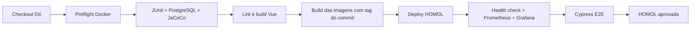

# Pipeline as code, homologação e observabilidade

O fluxo foi inspirado em [Jogo Enigma API V5.1](https://github.com/Lpaifer/jogo-enigma-api-v1-A2-portavel-v5.1/tree/main), referência consultada no commit `df1a274d7f34cf32b5e9e56dd8c19728a4b00c9f`. A aplicação continua sendo Java 26/Spring Boot com frontend Vue, sem acrescentar um BFF Node à arquitetura.

## Fluxo versionado



O `Jenkinsfile` suporta agentes Windows (`bat`) e Linux/macOS (`sh`). Todas as ferramentas de build/testes executam em contêineres. O agente precisa de Git, Docker Engine ativo e Docker Compose v2.20 ou superior; não precisa de Maven, Java 26, Node ou Cypress instalados globalmente. A alternativa Jenkins em Docker já fornece Git, Docker CLI/Compose e os plugins.

| Etapa | Critério de aprovação | Evidência |
|---|---|---|
| Backend | 25 testes da suíte normal e um IT PostgreSQL aprovados após o mini-lab B1 | Surefire/Failsafe, JAR |
| Cobertura | Zero instruções, branches ou linhas descobertos nas classes analisadas | JaCoCo HTML/CSV/XML |
| Frontend | Oxlint/ESLint sem erros e build Vite concluído | Console do build |
| Deploy | Banco, API, frontend, Prometheus e Grafana prontos | Estado dos serviços e logs |
| Observabilidade | API UP, proxy funcional, métricas presentes, `up=1`, datasource/dashboard provisionados | Smoke checks |
| E2E | Dez cenários Cypress aprovados | JUnit XML, vídeo e screenshots de falhas |

O parâmetro `DEPLOY_HOMOL=false` executa CI e gera as imagens, sem implantação/testes de homologação. HOMOL usa um lock para impedir deployments simultâneos entre jobs no mesmo Jenkins. As imagens têm tag `BUILD_NUMBER-commit`, e relatórios antigos são removidos antes do checkout. O job guarda 15 builds e artefatos dos últimos 10.

Falhas reprovam o pipeline. Se uma falha ocorrer depois do deploy, o candidato permanece em HOMOL para diagnóstico; não há rollback automático nem promoção para produção. O banco descartável de CI é removido ao final; os volumes de HOMOL são preservados. Os dados de Cypress usam nomes exclusivos e permanecem no banco de homologação.

Os Dockerfiles de Java, frontend e Cypress fazem até três tentativas dos comandos de preparação/empacotamento, com intervalo de três segundos, para tolerar downloads interrompidos de dependências. Se todas falharem, o build é reprovado. Os comandos de testes mantêm seus critérios de falha; o Cypress mantém a configuração de repetição já definida em `cypress.config.js`.

## Arquivos

| Arquivo/diretório | Finalidade |
|---|---|
| `Jenkinsfile` | Pipeline declarativo e publicação de evidências |
| `docker-compose.ci.yml`, `ci/Dockerfile.backend` | Java 26/Maven Wrapper e PostgreSQL descartável de testes |
| `frontend/Dockerfile.ci` | Lint e build Vue em Node |
| `docker-compose.homol.yml` | PostgreSQL, API, Nginx/Vue, pgAdmin, Prometheus, Grafana e perfis de verificação |
| `docker-compose.jenkins.yml`, `jenkins/` | Jenkins e daemon Docker interno com TLS |
| `frontend/cypress.config.js`, `frontend/cypress/` | Configuração e cenários Cypress |
| `prometheus/` | Coleta de métricas e regras de alertas |
| `grafana/` | Datasource e dashboard provisionados |
| `scripts/smoke-homol.mjs` | Verificação da aplicação e observabilidade |
| `.env.example` | Portas e credenciais locais de laboratório |

## Preparar a configuração local

Na raiz do projeto, copie `.env.example` para `.env` e ajuste os valores desejados. No PowerShell:

```powershell
Copy-Item .env.example .env
docker version
docker compose version
```

No Linux/macOS: `cp .env.example .env`. O `.env` é ignorado pelo Git e pelos builds Docker. As senhas de laboratório têm valores padrão para permitir a primeira execução local. Defina suas credenciais antes de criar os volumes: alterar as variáveis depois não muda senhas já gravadas no PostgreSQL, pgAdmin ou Grafana.

| Serviço | Desenvolvimento | HOMOL |
|---|---:|---:|
| API | 8080 | 8082 |
| Frontend | 5173 | 5174 |
| pgAdmin | 5050 | 5051 |
| Prometheus | — | 9091 |
| Grafana | — | 3001 |
| Jenkins | — | 8080 |

O PostgreSQL de HOMOL fica acessível pela rede Docker, sem publicar uma porta no host. No pgAdmin, registre host `db`, porta `5432`, banco `gamificacao_homol`, usuário `gamificacao` e a senha de `HOMOL_DATABASE_PASSWORD`.

## Executar Jenkins em Docker

```sh
docker compose -f docker-compose.jenkins.yml up --build -d
docker compose -f docker-compose.jenkins.yml exec -T jenkins cat /var/jenkins_home/secrets/initialAdminPassword
```

Abra <http://localhost:8080/>, desbloqueie com a senha exibida e crie seu usuário administrador. Os plugins Pipeline, Git, JUnit, HTML Publisher e Lockable Resources já estão instalados pela imagem. O Jenkins roda com Java 21; o build da aplicação usa Java 26 em seu próprio contêiner. A porta HTTP do Jenkins é definida na instalação ou no Compose, e não no `Jenkinsfile`.

Crie um item do tipo **Pipeline**:

1. Em **Pipeline**, selecione **Pipeline script from SCM**.
2. Selecione **Git** e informe o repositório que contém estes arquivos, por exemplo `https://github.com/Lpaifer/Grupo_5_PraticaATDD.git`.
3. Para um repositório privado, configure uma credencial Git no Jenkins e selecione-a no SCM.
4. Informe a branch que recebeu a implementação, por exemplo `*/main`, e o **Script Path** `Jenkinsfile`.
5. Salve e execute **Build Now**. Depois do primeiro build, use **Build with Parameters** para escolher `DEPLOY_HOMOL`.

Os arquivos precisam estar na branch remota selecionada para que o checkout do Jenkins os encontre. O job também pode ser criado como Multibranch Pipeline. Disparo por webhook depende da configuração de acesso ao Jenkins; inicialmente execute pelo botão de build.

O Compose do Jenkins usa Docker-in-Docker com TLS e daemon próprio. O volume de `jenkins_home` é montado no mesmo caminho em ambos os contêineres, permitindo que o daemon interno leia os bind mounts do Prometheus/Grafana no workspace. O daemon interno exige `privileged`, conforme a instalação Docker documentada pelo Jenkins; sua porta de controle não é publicada no computador. As portas da aplicação são encaminhadas pelo contêiner DinD e limitadas a `127.0.0.1` no host.

O deploy realizado por esse Jenkins fica no **daemon interno**. Para inspecioná-lo:

```sh
docker compose -f docker-compose.jenkins.yml exec -T jenkins docker ps
docker compose -f docker-compose.jenkins.yml logs --tail=100 jenkins docker
```

Use este Jenkins em Docker ou a HOMOL manual abaixo por vez, pois os dois modos usam as mesmas portas externas. `docker compose -f docker-compose.jenkins.yml down` para os serviços sem apagar volumes. Jenkins, imagens internas e dados de homologação ficam preservados nos volumes.

## Executar com um Jenkins já instalado

Para a instalação informada pelo grupo, acesse <http://localhost:8080/> e utilize o Java **21.0.12** que já executa o Jenkins. Os testes e o build da aplicação usam Java **26** nas imagens Docker; o pipeline não chama `java` ou Maven diretamente no computador. A API de HOMOL é publicada na porta **8082**, permitindo executar o pipeline enquanto o Jenkins ocupa a porta 8080. A API de desenvolvimento em `compose.yaml` também usa 8080 por padrão; para executá-la ao mesmo tempo, configure outra `API_PORT` nesse ambiente.

Instale os plugins de `jenkins/plugins.txt`, confirme que o usuário do agente tem acesso ao Docker e configure o mesmo job **Pipeline script from SCM**. O Jenkinsfile usa `bat` no Windows e `sh` no Unix; o Docker Desktop deve usar contêineres Linux. Não configure instalações Maven/Node/Java 26 no Jenkins: o pipeline usa as imagens versionadas neste projeto.

As variáveis `HOMOL_*` podem ser configuradas no ambiente do agente ou em seu `.env` local. Não versione senhas. O job de laboratório usa credenciais padrão quando nenhuma variável é definida; para credenciais privadas, use o armazenamento de credenciais do Jenkins e injete-as no ambiente do job.

## Executar CI sem Jenkins

```sh
docker compose -p grupo5-ci-local -f docker-compose.ci.yml build backend frontend
docker compose -p grupo5-ci-local -f docker-compose.ci.yml run --name grupo5-ci-backend backend
docker compose -p grupo5-ci-local -f docker-compose.ci.yml run --rm --no-deps frontend
```

O backend executa `./mvnw -B -ntp -Ppostgres-it clean verify`. Surefire executa a suíte normal com H2; Failsafe executa `PostgresPersistenceIT` no PostgreSQL real do Compose. O perfil `postgres-test` utiliza `CI_DATABASE_*` e `create-drop` apenas nesse banco descartável. O perfil `homol` usa outras variáveis/banco e mantém os dados entre deployments.

Para coletar a evidência antes de remover o contêiner, crie `artifacts/backend` e execute:

```sh
docker cp grupo5-ci-backend:/workspace/target/. artifacts/backend/
docker compose -p grupo5-ci-local -f docker-compose.ci.yml down --volumes --remove-orphans
```

No PowerShell, crie a pasta com `New-Item -ItemType Directory -Force artifacts/backend`; no Unix, `mkdir -p artifacts/backend`. Essa limpeza remove apenas o projeto descartável `grupo5-ci-local`. O comando Maven sem o perfil (`.\mvnw.cmd verify` ou `./mvnw verify`) continua funcionando sem Docker e executa os 25 testes normais após o mini-lab B1.

## Executar HOMOL sem Jenkins

```sh
docker compose -f docker-compose.homol.yml up --build -d --wait --wait-timeout 180 db api frontend pgadmin prometheus grafana
docker compose -f docker-compose.homol.yml --profile checks run --build --rm smoke
docker compose -f docker-compose.homol.yml --profile e2e run --build --name grupo5-e2e-local cypress
```

Abra frontend <http://localhost:5174/>, Swagger <http://localhost:8082/swagger-ui.html>, pgAdmin <http://localhost:5051/>, Prometheus <http://localhost:9091/> e Grafana <http://localhost:3001/>. O Grafana usa `HOMOL_GRAFANA_USER`/`HOMOL_GRAFANA_PASSWORD`; por padrão, `admin`/`admin_homol`.

Os perfis `checks` e `e2e` impedem que smoke/Cypress sejam iniciados como serviços permanentes. O Cypress não depende do navegador do computador: a imagem inclui Cypress e Electron. A execução cobre a interface Vue, o proxy Nginx, a API e a persistência no PostgreSQL. O teste de falha de rede simula apenas a requisição específica; os demais fluxos usam o backend real.

Para preservar relatórios, crie `artifacts/cypress` e copie os resultados mesmo em caso de falha:

```sh
docker cp grupo5-e2e-local:/e2e/cypress/. artifacts/cypress/
docker rm grupo5-e2e-local
```

Em uma execução rápida sem guardar evidências, use `run --build --rm cypress`. Para diagnosticar os serviços:

```sh
docker compose -f docker-compose.homol.yml ps
docker compose -f docker-compose.homol.yml logs --tail=100 api frontend prometheus grafana
docker compose -f docker-compose.homol.yml down
```

O último comando preserva os volumes e dados. Não adicione `--volumes` para uma parada normal.

## Monitoramento

O Actuator expõe `/actuator/health`, `/actuator/info` e `/actuator/prometheus`. O health check considera o banco; detalhes internos não são expostos na resposta pública. Prometheus coleta a API pela rede interna em `api:8080` a cada 15 segundos. Não é necessário publicar `/actuator` pelo frontend.

No Grafana, abra a pasta **Grupo 5** e o dashboard **Grupo 5 — Homologação**, UID `grupo5-homol`. Há painéis de disponibilidade, uptime, CPU, conexões PostgreSQL, taxa de requisições, latência média, memória JVM e respostas por status HTTP. Os painéis com `rate` precisam de pelo menos duas coletas; gere tráfego na interface e aguarde alguns segundos para visualizar as séries.

Em Prometheus, consulte `up{job="grupo5-api"}`: o valor esperado é `1`. As regras `ApiIndisponivel` e `TaxaElevadaDeErrosHttp` ficam na página **Alerts**. Elas avaliam condições no Prometheus; envio de notificações externas/Alertmanager não está configurado.

## Fontes técnicas

A [validação local de 12/10/2026](DevOps-validacao.md) registra os resultados e os artefatos gerados.

A [validação do mini-lab B1 em 28/10/2026](arquitetura/evidencias/desafio-1/validacao.md) registra a execução direta dos comandos de CI/HOMOL após a modularização: 25 testes normais, um IT PostgreSQL e dez cenários Cypress aprovados, com cobertura integral e smoke checks. O job Jenkins não foi disparado nessa execução.

- [Sintaxe de pipeline declarativo Jenkins](https://www.jenkins.io/doc/book/pipeline/syntax/)
- [Jenkins em Docker e Docker-in-Docker com TLS](https://www.jenkins.io/doc/book/installing/docker/)
- [Inicialização e health checks no Compose](https://docs.docker.com/compose/how-tos/startup-order/)
- [Cypress em integração contínua](https://docs.cypress.io/app/continuous-integration/overview)
- [Métricas Spring Boot e Prometheus](https://docs.spring.io/spring-boot/reference/actuator/metrics.html)
- [Configuração Prometheus](https://prometheus.io/docs/prometheus/latest/configuration/configuration/)
- [Provisionamento Grafana](https://grafana.com/docs/grafana/latest/administration/provisioning/)
