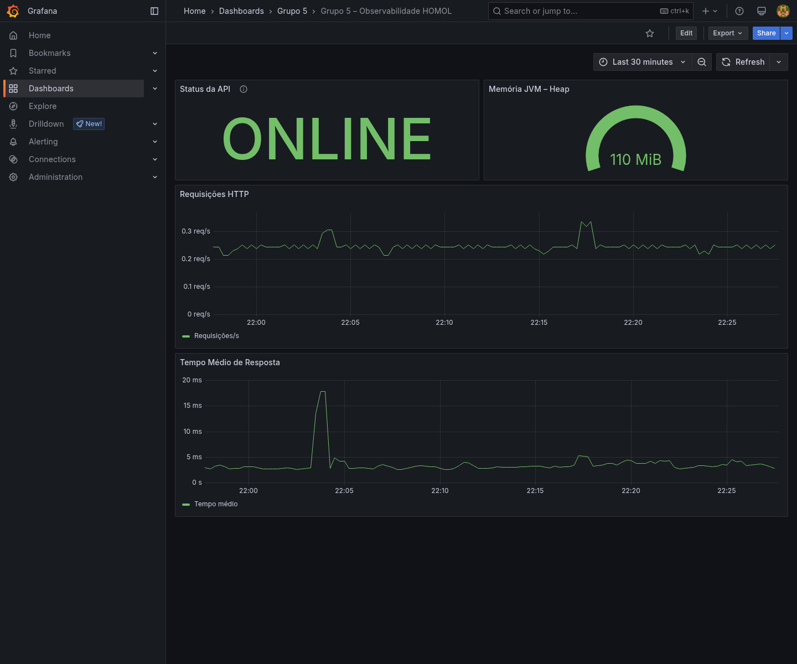
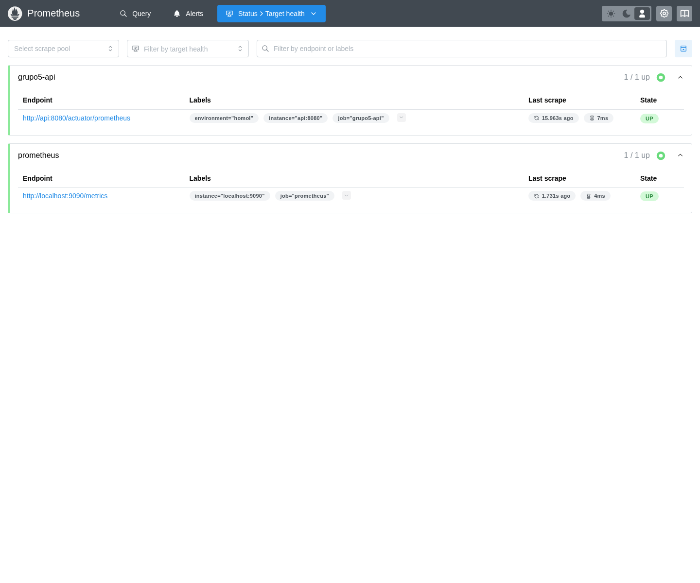

# Questões para fechamento — A2

As respostas abaixo se referem à esteira deste projeto, definida no [Jenkinsfile](../Jenkinsfile). O dashboard da questão 6 segue o tutorial Grafana fornecido pelo grupo no Canvas, com os nomes e as credenciais adaptados para Educação Continuada Gamificada.

## 1. Em que ponto termina CI e começa entrega/implantação contínua?

A Integração Contínua valida as alterações do repositório: checkout, testes JUnit, integração com PostgreSQL, cobertura JaCoCo, lint e build Vue. No recorte desta esteira, ela termina depois de **CI - Qualidade e build Vue**, quando o backend e o frontend já foram testados e compilados.

A preparação da entrega começa em **Build das imagens**, que empacota a versão aprovada. A implantação efetiva começa no estágio **Deploy HOMOL**, que utiliza essas imagens para atualizar o ambiente de homologação. Em seguida, os health checks, a observabilidade e o Cypress verificam a versão implantada. A entrega contínua mantém uma versão pronta para liberação; a implantação contínua automatiza a instalação dessa versão em um ambiente. Aqui, a implantação em HOMOL é automática quando `DEPLOY_HOMOL` está habilitado; promoção para produção não faz parte da esteira.

## 2. Qual vantagem arquitetural o Jenkinsfile oferece em relação a Freestyle?

O Jenkinsfile implementa **pipeline as code**: a sequência de build, testes, implantação e tratamento de falhas fica versionada junto da aplicação. Isso permite revisar alterações, identificar quem mudou a esteira, recuperar versões anteriores e reproduzir o fluxo em outro Jenkins com os plugins e ferramentas necessários.

Em uma configuração exclusivamente Freestyle, os passos ficam distribuídos nas configurações dos jobs. O Jenkinsfile centraliza a orquestração e representa explicitamente estágios, condições, dependências, bloqueios e publicação de evidências. [Documentação Jenkins Pipeline](https://www.jenkins.io/doc/book/pipeline/).

## 3. Por que JUnit antes da imagem/deploy e Cypress depois do deploy?

Os testes JUnit verificam as regras de negócio e as integrações do backend antes de gerar e implantar a imagem final da aplicação. Uma reprovação interrompe a esteira e evita atualizar HOMOL com uma versão que já apresenta defeitos conhecidos.

O Cypress verifica o comportamento ponta a ponta: navegador, Vue, proxy Nginx, API e PostgreSQL. Por isso, nesta esteira ele roda depois do deploy e dos health checks, com os serviços disponíveis na rede de homologação. Assim também verifica problemas de configuração e integração que os testes do backend isoladamente podem não revelar. [Cypress em CI](https://docs.cypress.io/app/continuous-integration/overview).

Neste projeto, os próprios testes JUnit executam em um contêiner de CI. A ordem exigida é executar os testes antes da criação/implantação da **imagem final da aplicação**, e não antes de qualquer uso de Docker.

## 4. Como observabilidade se relaciona com qualidade após a implantação?

A observabilidade permite acompanhar a qualidade com a aplicação em execução: disponibilidade, quantidade de requisições, tempo de resposta, falhas HTTP e consumo de recursos. Essas informações ajudam a identificar regressões e investigar problemas que aparecem sob condições reais de uso.

No projeto, o Spring Boot expõe métricas em `/actuator/prometheus`, o Prometheus coleta e armazena essas séries, e o Grafana transforma os dados em indicadores e gráficos. Dessa forma, a verificação de qualidade continua depois do deploy, apoiando correções com dados de execução. [Prometheus](https://prometheus.io/docs/introduction/overview/).

## 5. Qual conhecimento da A1 foi reutilizado diretamente?

Considerando a prática ATDD documentada neste repositório como a base da A1, foram reutilizados os testes automatizados com **JUnit**, a execução pelo **Maven Wrapper**, a análise de cobertura com **JaCoCo** e a tradução dos critérios de aceitação em cenários verificáveis.

O que antes era executado localmente passou a ser uma etapa automática da CI. As regras de nota mínima, curso concluído, nova tentativa e acúmulo de cursos também foram reutilizadas nos cenários Cypress. A identificação exata com a A1 deve ser conferida com seu enunciado, pois as fontes desta resposta são o [README](../README.md) e a [rastreabilidade ATDD](US-e-rastreabilidade.md) deste projeto.

## 6. Dashboard Grafana conforme o tutorial Canvas

Foi criado o dashboard **Grupo 5 – Observabilidade HOMOL**, com UID `grupo5-observabilidade-homol`. A definição está versionada em [`grupo5-observabilidade-homol.json`](../grafana/dashboards/grupo5-observabilidade-homol.json) e será provisionada nos próximos deployments Jenkins.

Na homologação atual, o dashboard também foi salvo no Grafana e está disponível em:

<http://localhost:3001/d/grupo5-observabilidade-homol>

Login: `admin`. Senha configurada neste projeto: `admin_homol`.

| Painel | Visualização | Consulta |
|---|---|---|
| Status da API | Stat, com ONLINE/OFFLINE | `up{job="grupo5-api"}` |
| Requisições HTTP | Time series | `sum(rate(http_server_requests_seconds_count{job="grupo5-api"}[1m]))` |
| Tempo Médio de Resposta | Time series | `sum(rate(http_server_requests_seconds_sum{job="grupo5-api"}[1m])) / sum(rate(http_server_requests_seconds_count{job="grupo5-api"}[1m]))` |
| Memória JVM – Heap | Gauge, em bytes IEC | `sum(jvm_memory_used_bytes{job="grupo5-api",area="heap"})` |

O layout segue o tutorial: Status e Heap lado a lado no topo, Requisições HTTP abaixo e Tempo Médio de Resposta na última linha. As consultas de taxa usam a janela de um minuto. O datasource permanece **Prometheus**, UID `prometheus`, conectado pela rede Docker em `http://prometheus:9090`.

Adaptações do tutorial para este projeto: o target `jogo-enigma-api` foi substituído por `grupo5-api`, e o nome do dashboard identifica o Grupo 5. As portas externas são Jenkins `8080`, Prometheus `9091` e Grafana `3001`; a API de HOMOL está em `8082`.

### Prints para entrega

1. Abra o dashboard e tire um print mostrando os **quatro painéis**, o nome do dashboard e o status **ONLINE**. Use um intervalo recente, por exemplo os últimos 30 minutos, com atualização a cada 15 segundos. Acesse o frontend/API para gerar tráfego e aguarde pelo menos duas coletas do Prometheus para os gráficos de taxa.
2. Abra <http://localhost:9091/targets>, localize o target **grupo5-api** e tire um print mostrando **UP** e o endpoint `http://api:8080/actuator/prometheus`.

O tutorial pede o alvo `jogo-enigma-api` porque utiliza outra aplicação; nas evidências deste projeto, o alvo correto é `grupo5-api`.

### Evidências capturadas no ambiente em execução

As capturas abaixo mostram os quatro painéis preenchidos e o target da API como UP. As quatro consultas também foram verificadas diretamente no Prometheus, e o teste da conexão do datasource retornou `OK`.

