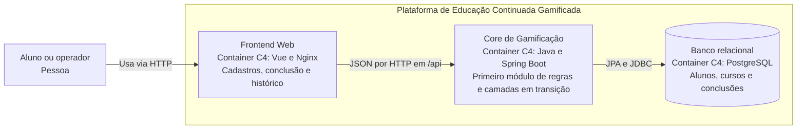
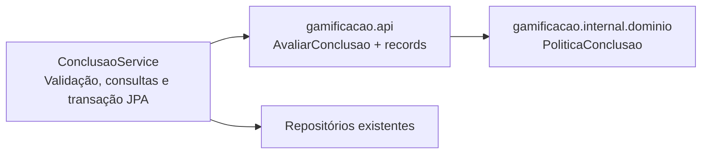

# Arquitetura B1 do Grupo 5

Registro cumulativo das decisões arquiteturais da plataforma de Educação Continuada Gamificada. A evolução parte do MVP da AC1 e preserva suas regras, contratos HTTP e persistência enquanto introduz fronteiras entre capacidades de negócio.

**Desafio 1 — decisão:** evoluir o Core de monólito em camadas para monólito modular, mantendo uma aplicação Java/Spring Boot e banco relacional. **Situação em 28/10/2026:** primeiro recorte de aprovação e recompensa implementado e validado localmente e em Docker/HOMOL, com contrato público e verificação arquitetural. A [comparação de dependências](evidencias/desafio-1/dependencias.md) e a [validação](evidencias/desafio-1/validacao.md) registram 25 testes da suíte normal, um teste PostgreSQL e dez cenários Cypress aprovados, além de cobertura integral e smoke checks. A modularização completa de Alunos, Cursos e Gamificação continua como evolução futura.

O formato e a decisão seguem o exemplo orientativo da professora. A adaptação utiliza as funcionalidades existentes no repositório e acrescenta critérios verificáveis para as dependências entre módulos. Os Desafios 2 a 6 terão seus próprios registros quando forem discutidos.

## 1 Leitura do cenário

O enunciado prevê crescimento de aproximadamente 1.000 para até 100.000 usuários, com aumento de demanda especialmente no Ranking. Esses números representam o cenário do exercício; não são medições de usuários ou de capacidade deste projeto. Quantidade de usuários cadastrados, concorrência e requisições por segundo devem ser distinguidas em futuras avaliações de carga.

Na base anterior ao mini-lab, o Core estava organizado por camadas técnicas: `api`, `service`, `domain`, `entity` e `repository`. O primeiro recorte acrescenta o módulo `gamificacao` e mantém as demais camadas em transição. Alunos, cursos e conclusões compartilham aplicação e banco. A aprovação exige curso concluído e nota mínima de 7,0; cada aprovação acrescenta três cursos ao saldo, preservando todas as tentativas no histórico.

O case B1 também menciona Ranking, moedas, badges, múltiplas instituições, IA, notificações e IoT. Essas capacidades ainda não estão implementadas no MVP. A modularização inicial utiliza o fluxo existente de conclusão e recompensa; a fronteira de Ranking será definida quando seus requisitos forem detalhados.

**Pergunta do Tech Lead:** quais fronteiras internas permitem evoluir o produto com menor acoplamento, mantendo uma operação compatível com seis desenvolvedores? Há evidência de que uma capacidade precise de escala ou deploy independente agora?

## 2 RFs afetados

Os identificadores RF01 e RF02 mantêm o significado do enunciado. Os identificadores AC1 abaixo permitem rastrear funcionalidades já implementadas sem renumerar os requisitos do B1.

| ID | Requisito funcional | Situação e impacto no desafio |
| --- | --- | --- |
| RF01 | Ranking | Previsto no case; crescimento desigual orienta uma possível fronteira futura, sem implementação de ranking neste mini-lab. |
| RF02 | Conquistas e gamificação | O MVP implementa a recompensa de três cursos por aprovação; moedas e badges permanecem como evolução prevista. |
| AC1-01 | Cadastrar e consultar alunos e planos | Preservar cadastros, planos Básico/Premium e consultas existentes. |
| AC1-02 | Cadastrar e listar cursos | Preservar o catálogo utilizado nas conclusões. |
| AC1-03 | Registrar tentativas e determinar aprovação | Preservar validação de nota, condição de conclusão e limite de aprovação em 7,0. |
| AC1-04 | Acumular recompensas e consultar histórico | Preservar saldo e tentativas, inclusive reprovação seguida de aprovação e nova aprovação no mesmo curso. |

O [contrato da API](../API_CONTRACT.md) e os [cenários ATDD](../US-e-rastreabilidade.md) detalham o comportamento da AC1 que deverá continuar válido.

## 3 RNFs e seleção dos ASRs

RNF é um requisito não funcional. ASR é o requisito arquiteturalmente significativo selecionado por influenciar estrutura, comunicação, dados, implantação ou operação. A seleção deste desafio contém três ASRs.

| RNF | Referência FURPS+ | ASR neste desafio | Justificativa |
| --- | --- | --- | --- |
| Manutenibilidade | Suportabilidade | Sim — ASR-01 | Fronteiras por capacidade e contratos explícitos devem limitar o impacto das alterações e o acesso a detalhes internos. |
| Escalabilidade | Desempenho e capacidade | Sim — ASR-02 | O crescimento desigual previsto para Ranking orienta uma fronteira passível de extração futura, condicionada a medições. |
| Complexidade operacional | Suportabilidade e restrições operacionais | Sim — ASR-03 | A equipe de seis pessoas deve operar o Core com um único deploy, evitando acrescentar comunicação distribuída entre suas capacidades nesta etapa. |
| Desempenho | Desempenho | Não como driver macro agora | Ainda não há ensaio de carga que caracterize latência, throughput ou saturação e sustente decomposição por desempenho. |
| Testabilidade | Suportabilidade | Não como driver macro agora | É critério de validação da mudança; isoladamente não determina a separação do Core em serviços. |

### Matriz cumulativa de ASRs

| ASR | Origem | Efeito arquitetural | Evidência | Estado |
| --- | --- | --- | --- | --- |
| ASR-01 — Manutenibilidade | RF02 e evolução AC1 | Módulos com contratos públicos e implementação encapsulada | [Dependências e rejeição de violações](evidencias/desafio-1/dependencias.md), testes de regressão | Validado no primeiro recorte; demais capacidades em transição |
| ASR-02 — Escalabilidade | RF01 e cenário de crescimento | Preservar possibilidade de extração seletiva sem distribuir o Core agora | Registrar fronteiras e gatilhos de revisão; capacidade dependerá de ensaio de carga posterior | Premissa de evolução; capacidade não demonstrada |
| ASR-03 — Complexidade operacional | RF01/RF02 e equipe de seis pessoas | Manter uma aplicação Core, uma imagem e um deploy do backend | [Execução local e Docker/HOMOL](evidencias/desafio-1/validacao.md), com o mesmo conjunto de serviços | Validado no primeiro recorte; uma aplicação Core, com smoke e Cypress aprovados |

Os próximos desafios deverão atualizar esta matriz. Um RNF pode tornar-se ASR em outra decisão quando influenciar uma fronteira ou mecanismo específico.

## 4 RPCs e consequências

RPC identifica requisito, premissa ou restrição que limita a solução.

| RPC | Consequência para a decisão |
| --- | --- |
| Core existente em Java/Spring Boot | Preservar a aplicação e reaproveitar o código da AC1; manter Java 26 e a configuração atual nesta etapa. |
| Equipe de seis desenvolvedores | Manter o custo de implantação, diagnóstico e manutenção proporcional à equipe. |
| Banco relacional e dados existentes | Preservar PostgreSQL em Docker/HOMOL e H2 nos perfis locais e testes aplicáveis. |
| Legado funcional da AC1 | Manter endpoints, respostas, validações, histórico e cálculo da recompensa. |
| Evolução incremental | Executar um recorte modular verificável antes de ampliar a reorganização do Core. |

As tecnologias existentes são restrições de continuidade e contexto operacional. A escolha por monólito modular é a decisão resultante, não uma RPC.

## 5 Alternativas e trade-offs

| Alternativa | Benefícios | Custos e riscos | Avaliação |
| --- | --- | --- | --- |
| A — Monólito em camadas | Continuidade imediata, transações locais e operação simples | Fronteiras de negócio pouco explícitas; serviços podem acessar livremente repositórios de capacidades diferentes | Viável para o MVP, mas exige disciplina adicional conforme o produto cresce. |
| B — Monólito modular | Contratos entre capacidades, operação conjunta e evolução incremental; facilita uma possível extração posterior | Requer definir e verificar fronteiras; processo, recursos, banco e deploy continuam compartilhados | Escolhida pelo equilíbrio entre os três ASRs e as RPCs. |
| C — Decomposição seletiva em serviços | Permite escala e deploy independentes da capacidade extraída | Introduz rede, falhas parciais, contratos remotos, decisões de consistência e mais unidades operacionais | Reavaliar quando houver necessidade demonstrada de autonomia ou escala independente. |

Uma previsão de crescimento justifica preparar e observar fronteiras. A decisão de distribuir uma capacidade exigirá evidência adicional sobre carga, frequência de implantação ou isolamento de falhas.

## 6 Decisão do Tech Lead

**Adotar monólito modular como direção de evolução do Core.** As capacidades continuam no mesmo processo Spring Boot e utilizam chamadas locais. A primeira implementação encapsula as regras de aprovação e concessão de cursos adicionais, com contratos que expõem dados de negócio e ocultam sua implementação.

As fronteiras propostas para a evolução são:

| Capacidade | Responsabilidade | Contratos e limites previstos |
| --- | --- | --- |
| Alunos | Cadastro, plano e manutenção do saldo associado ao aluno | Consultar dados e atualizar saldo por operações explícitas; entidades e repositórios ficam na implementação. |
| Cursos | Cadastro e consulta do catálogo | Disponibilizar identificação e dados do curso sem expor JPA. |
| Gamificação | Aprovação, cálculo da recompensa, processamento de tentativas e consulta do histórico | Consumir contratos de Alunos e Cursos; manter suas regras e detalhes de histórico encapsulados. |

Conclusão e recompensa permanecem na mesma capacidade inicialmente porque compõem o fluxo existente e sua regra transacional. Moedas e badges poderão exigir novas responsabilidades futuramente; sua simples menção no case não define módulos implementados agora.

O saldo pertence aos dados de Alunos, enquanto a regra que determina seu acréscimo pertence à Gamificação. Na evolução completa, Gamificação deverá coordenar a atualização por contrato de Alunos na mesma transação local do registro da tentativa. A consulta de histórico será responsabilidade de Gamificação; a resposta HTTP atual do aluno poderá compor os dados dos dois contratos sem expor repositórios entre módulos.

O primeiro recorte não precisa mover toda a persistência. O restante das camadas existentes será identificado como legado em transição, e a conclusão do mini-lab não será apresentada como modularização completa do Core.

Ranking permanece como candidato futuro a uma fronteira própria. Sua eventual extração dependerá de requisitos e métricas que justifiquem o custo operacional.

## 7 ADR-001 Evolução do Core para monólito modular

| Campo | Registro |
| --- | --- |
| Título | ADR-001 — Evoluir o Core de monólito em camadas para monólito modular |
| Data | 21/10/2026 |
| Estado | Decisão adotada em 21/10/2026; primeiro recorte implementado e validado localmente e em Docker/HOMOL em 28/10/2026. Ampliação das fronteiras permanece como evolução futura; Jenkins não foi disparado nesta validação. |
| Contexto | MVP com cadastros, conclusões, histórico e recompensa; cenário B1 de crescimento e futuras capacidades com ritmos de evolução distintos. |
| ASRs | ASR-01 Manutenibilidade; ASR-02 Escalabilidade; ASR-03 Complexidade operacional. |
| RPCs | Java/Spring Boot; seis desenvolvedores; banco relacional; preservação do legado AC1 e evolução incremental. |
| Alternativas | A) Camadas atuais; B) Monólito modular; C) Decomposição seletiva em serviços. |
| Decisão | Introduzir fronteiras por capacidade no Core, começando pelas regras de aprovação e recompensa, com um processo e deploy do backend. |
| Consequências positivas esperadas | Dependências explícitas, regras encapsuladas e menor necessidade de reorganização caso uma capacidade seja extraída futuramente. |
| Custos e trade-offs | Definição e verificação de contratos; refatoração incremental; recursos e falhas de processo compartilhados; deploy conjunto e ausência de escala independente por módulo. |
| Validação | Mini-lab, comparação de dependências, testes das fronteiras, regressão funcional e verificação da implantação existente. |
| Gatilhos de revisão | Gargalo reproduzível sob carga representativa, necessidade recorrente de deploy independente ou requisito de isolamento incompatível com processo compartilhado. Registrar alternativas antes de extrair. |

## 8 C4 na visão de Container

A visão abaixo representa a implantação Docker/HOMOL mantida pelo primeiro recorte modular; sua execução nesta revisão é identificada nas evidências de validação. O Core continua sendo um único container C4: uma aplicação executável. Módulos Java são organização interna dessa aplicação, não novos serviços ou contêineres Docker.



O diagrama usa o ambiente Docker/HOMOL com PostgreSQL. Os perfis locais e os testes aplicáveis continuam podendo usar H2. Jenkins, Prometheus, Grafana e pgAdmin permanecem na infraestrutura existente; o Desafio 1 não introduz unidades operacionais adicionais. A visão de componentes do Core será detalhada no Desafio 2, acompanhando as fronteiras efetivamente implementadas.

## 9 Mini-lab implementado

### Hipótese e recorte

**Hipótese:** as regras existentes de aprovação e recompensa podem ser encapsuladas em um módulo com acesso por contrato público, preservando o comportamento e mantendo a implantação conjunta.

O recorte implementa a avaliação de uma conclusão e o cálculo do saldo resultante. A orquestração de persistência continua no serviço existente. Isso permite avaliar uma fronteira de negócio sem incluir, no mesmo experimento, troca de persistência ou comunicação distribuída.

### Estrutura anterior ao recorte

Os caminhos abaixo são relativos a `src/main/java/org/example/grupo_5_praticaatdd/`.

```text
api/
  AlunoController.java
  CursoController.java
  ConclusaoController.java
  dto/
service/
  AlunoService.java
  CursoService.java
  ConclusaoService.java
domain/
  Aluno.java
  Plano.java
  Curso.java
  ConclusaoCurso.java
  PlataformaGamificacao.java
entity/
  AlunoEntity.java
  CursoEntity.java
  ConclusaoEntity.java
repository/
  AlunoRepository.java
  CursoRepository.java
  ConclusaoRepository.java
```

Na base `e112d7db12c292030c6980f98814f42de7903c38`, `ConclusaoService` acessava três repositórios, instanciava objetos de domínio, invocava `PlataformaGamificacao`, atualizava saldo e registrava a tentativa. As regras já eram Java puro, mas o chamador conhecia as classes utilizadas para processá-las.

### Estrutura implementada no primeiro recorte

```text
gamificacao/
  api/
    AvaliarConclusao.java
    DadosConclusao.java
    ResultadoConclusao.java
  internal/
    dominio/
      PoliticaConclusao.java
api/          # controllers e DTOs HTTP existentes
service/      # orquestração existente adaptada ao contrato do módulo
domain/
  Plano.java  # tipo ainda usado pelo cadastro e pela persistência
entity/       # persistência existente
repository/   # acesso a dados existente
```

`gamificacao.api` é o contrato Java público do módulo, distinto dos controllers REST do pacote `api` existente. A fachada concreta `AvaliarConclusao` recebe o record imutável `DadosConclusao(nota, concluido, cursosAdicionaisAtuais)` e retorna `ResultadoConclusao(aprovado, cursosAdicionais)`. A entrada contém valores já validados pela aplicação. O chamador não recebe entidades JPA nem objetos internos mutáveis. A fachada instancia a política interna sem depender de Spring.

As regras antes distribuídas entre `ConclusaoCurso` e `PlataformaGamificacao` foram adaptadas em `PoliticaConclusao`, com uma única implementação usada pelo fluxo real. Os antigos objetos de domínio `Aluno`, `Curso`, `ConclusaoCurso` e `PlataformaGamificacao`, usados somente nesse cálculo e seus testes, foram substituídos pelos valores do contrato. `Plano` permanece no legado por ser utilizado por `AlunoService` e `AlunoEntity`. Os oito testes de domínio foram adaptados para a API pública, preservando os nomes dos cenários ATDD.



O pacote `internal` não usa encapsulamento JPMS: a fronteira é protegida pelos testes de dependências no Maven. O módulo é Java puro, e os registros de tentativas, o histórico e o saldo persistido ainda pertencem às camadas legadas em transição.

### Etapas e critérios de implementação

| Etapa | Alteração realizada | Critério de aceitação |
| --- | --- | --- |
| 1 — Registrar a base | Estrutura, imports, revisão Git e resultados anteriores registrados nas evidências | Comparação vinculada à base identificável e ao diff local, sem apresentar resultados antigos como posteriores à refatoração. |
| 2 — Criar o contrato modular | Fachada `AvaliarConclusao` e records de entrada e saída criados | Valores de negócio na fronteira; ausência de entidades JPA ou dependência HTTP no contrato. |
| 3 — Encapsular as regras | Regra existente adaptada em `gamificacao.internal.dominio.PoliticaConclusao` | Nota mínima 7,0, conclusão obrigatória e acréscimo de três cursos preservados, sem duplicação da regra. |
| 4 — Integrar o fluxo existente | `ConclusaoService` adaptado para consumir o contrato público do recorte | Endpoint e JSON preservados; saldo e tentativa continuam na mesma transação local. |
| 5 — Verificar dependências | Três testes ArchUnit adicionados e rejeição de violações demonstrada | Falhar se código produtivo externo acessar `gamificacao.internal` ou se o recorte depender de controllers, serviços legados, JPA, Spring ou repositórios. |
| 6 — Preservar comportamento | Oito cenários adaptados ao contrato e regressão completa executada | 25 testes aprovados; cobertura integral mantida nas classes analisadas. |
| 7 — Coletar evidências | Comparação, testes, execução HTTP com H2 e validação Docker/HOMOL registrados | 36 testes automatizados aprovados no CI/E2E, cobertura integral, smoke e observabilidade; comandos executados diretamente, sem disparo Jenkins. |

`GamificacaoArchitectureTest` usa ArchUnit 1.4.2 em escopo de teste para analisar referências de tipos no bytecode produtivo. Suas três regras impedem acesso externo a `gamificacao.internal`, limitam dependências do módulo a Java e ao próprio módulo e impedem que os records da API exponham implementação interna. Testes são excluídos dessa análise. O [experimento controlado](evidencias/desafio-1/dependencias.md) introduziu referências proibidas em duas classes temporárias, confirmou duas falhas arquiteturais e removeu as classes antes da regressão limpa. A versão adotada possui [suporte oficial a Java 26](https://github.com/TNG/ArchUnit/releases/tag/v1.4.2).

### Comparação do recorte

| Aspecto | Antes | Depois no recorte |
| --- | --- | --- |
| Acesso às regras | Serviço conhece os objetos utilizados para executar a regra | Serviço chama o contrato público de avaliação. |
| Dependências | Separação por camada sem verificação específica de módulo | Nenhum acesso produtivo externo à implementação interna do recorte, com teste automatizado. |
| Testes | Testes puros do domínio e testes integrados existentes | Comportamento preservado e verificação adicional das fronteiras. |
| Persistência | Orquestrada pelo serviço com JPA | Continua no serviço nesta etapa, preservando transação e esquema. |
| Implantação | Uma aplicação e imagem do backend | Uma aplicação e imagem do backend. |

O experimento verifica encapsulamento e preservação funcional. Não comprova capacidade para 100.000 usuários, redução de latência ou escala independente.

### Regressão funcional obrigatória

- Curso concluído com nota exatamente 7,0 libera três cursos.
- Curso concluído com nota superior a 7,0 libera três cursos.
- Nota inferior a 7,0 ou curso incompleto mantém o saldo.
- Reprovação seguida de aprovação preserva ambas as tentativas e concede a recompensa da aprovação.
- Aprovações sucessivas acumulam o saldo; outra aprovação no mesmo curso continua concedendo três cursos.
- Planos Básico e Premium mantêm o comportamento atual.
- Notas inválidas e recursos inexistentes mantêm as respostas da API e não registram tentativas inválidas.
- Consultas preservam os dados do aluno e a ordem das tentativas no histórico.

### Verificação e reprodução

Com Java 26 configurado em `JAVA_HOME`, executar `./mvnw clean verify` ou, no Windows, `.\mvnw.cmd clean verify`. A verificação de dependências está integrada à suíte Maven. O [POM](../../pom.xml) mantém a exigência de cobertura integral de instruções, branches e linhas nas classes analisadas, com exclusão declarada da classe de inicialização. Os [resultados desta implementação](evidencias/desafio-1/validacao.md) distinguem a regressão local das verificações executadas em Docker/HOMOL.

Na verificação anterior à implementação, realizada em 21/10/2026 com `mvnw verify`, passaram 22 testes e os controles JaCoCo, com 729 instruções, 11 branches e 168 linhas cobertas nas 25 classes analisadas. A base foi novamente verificada no estudo de 28/10/2026 antes da alteração. Após o recorte, `clean verify` passou com 25 testes e cobertura integral de 682 instruções, 11 branches e 144 linhas nas 25 classes analisadas; detalhes e artefatos estão no [registro de validação](evidencias/desafio-1/validacao.md).

O CI descartável executou o perfil Maven `postgres-it`: 25 testes da suíte normal e um teste PostgreSQL passaram. A integração em HOMOL passou nos cinco smoke checks, na validação das duas regras de alerta do Prometheus e nos dez cenários Cypress. Os comandos Compose foram executados diretamente, conforme [DevOps e Jenkins](../DevOps-Jenkins.md); o job Jenkins não foi disparado. Durante essa validação, os Dockerfiles receberam tentativas limitadas nos downloads/empacotamento para tolerar interrupções de rede, sem alterar o conjunto de serviços, os testes ou contratos da aplicação.

### Continuidade no Desafio 2

A proteção das dependências técnicas do caso de uso será decidida em ADR próprio. A proposta a comparar é introduzir Ports & Adapters para permitir persistência JPA e em memória, mantendo o domínio e seus testes. Essa etapa complementa a modularização e não é necessária para apresentar o primeiro recorte como concluído.

Na ampliação das fronteiras, deverão ser tratados o acesso de `AlunoService` ao histórico e os relacionamentos JPA de `ConclusaoEntity` com aluno e curso. Mover essas entidades entre pacotes sem rever os acessos continuaria expondo detalhes internos. A escolha do mapeamento e da preservação das chaves estrangeiras deverá ser explícita antes dessa mudança.

## 10 Evidências para revisão no Git

O registro deste desafio é mantido neste README, incluindo ADR-001 e C4. A alteração inclui código, testes e relatos de evidência para revisão. A base é identificada pelo commit anterior; o estado posterior é o diff desta alteração, ainda sem commit próprio.

| Evidência | Local | Conteúdo mínimo |
| --- | --- | --- |
| Comparação de dependências | [dependencias.md](evidencias/desafio-1/dependencias.md) | Base antes/depois, consumidores da regra, acessos internos proibidos e resultado da verificação arquitetural. |
| Resultado dos testes | [validacao.md](evidencias/desafio-1/validacao.md) | Data, revisão Git, ambiente, comandos, totais de testes, cobertura e identificação das suítes executadas. |
| Rejeição de violação arquitetural | No registro de dependências | Referência introduzida apenas no experimento, falha produzida e confirmação de sua remoção. |
| Execução da aplicação | No registro de validação | Fluxo de conclusão, persistência, endpoints preservados e unidade de implantação do Core. |
| Artefatos completos | Build Jenkins ou pasta local `artifacts/` | Relatórios JUnit/JaCoCo, logs e evidências Cypress quando executado; registrar links ou identificadores no relato versionado. |

Os relatos de evidência estão em `docs/arquitetura/evidencias/desafio-1/`; os logs e relatórios completos estão na pasta local ignorada `artifacts/desafio-1/` e em `target/`. Capturas de tela podem complementar os resultados, sem substituir a identificação do experimento.

## 11 Conclusão da decisão e critérios de encerramento

A equipe adota a evolução para monólito modular por sua compatibilidade com o legado e com a capacidade operacional atual. O primeiro recorte torna explícito o acesso às regras de aprovação e recompensa, mantendo o fluxo transacional, a API e os cenários ATDD.

O primeiro recorte atende aos critérios técnicos de encerramento: contrato usado no fluxo real, verificação automatizada de dependências, rejeição de violações demonstrada, regressão funcional aprovada e evidências revisáveis. Os [resultados locais e em Docker/HOMOL](evidencias/desafio-1/validacao.md) delimitam a validação desta alteração; a publicação no Git depende do commit e da revisão pela equipe. A modularização completa do Core e a capacidade para 100.000 usuários não são resultados deste recorte.

A extração de Ranking ou de outra capacidade será revista mediante evidência de gargalo, necessidade de deploy independente ou isolamento. A conclusão do mini-lab deverá registrar o que foi demonstrado e o que ainda depende de medição.

## 12 Rastreabilidade final

| Elemento | Registro do Desafio 1 |
| --- | --- |
| RF | RF01 Ranking como evolução prevista; RF02 gamificação e funcionalidades AC1 de alunos, cursos, conclusões e recompensa. |
| RNF | Manutenibilidade, escalabilidade, complexidade operacional, desempenho e testabilidade analisados. |
| ASR | ASR-01 Manutenibilidade; ASR-02 Escalabilidade; ASR-03 Complexidade operacional. |
| RPC | Java/Spring Boot, seis desenvolvedores, banco relacional e legado AC1. |
| Alternativas | Camadas atuais, monólito modular e decomposição seletiva em serviços. |
| ADR | ADR-001 — Evoluir o Core para monólito modular. |
| C4 | Visão de Container com frontend, Core único e banco; Component detalhado no Desafio 2. |
| Evidência | [Dependências e rejeição de violações](evidencias/desafio-1/dependencias.md); [validação local e limitações](evidencias/desafio-1/validacao.md). |

### Referências

- Material da disciplina: `Exercicio_B1_Architecture_Lab_6_Desafios_Reavaliado.docx`, especialmente regras de entrega e Desafio 1.
- Exemplo orientativo da professora: `Exemplo_Solucao_Desafio_1_Architecture_Lab_B1.docx`; base da decisão por monólito modular e da organização das 12 seções.
- [README do projeto](../../README.md), [contrato da API](../API_CONTRACT.md), [rastreabilidade ATDD](../US-e-rastreabilidade.md) e [validação DevOps anterior](../DevOps-validacao.md).
